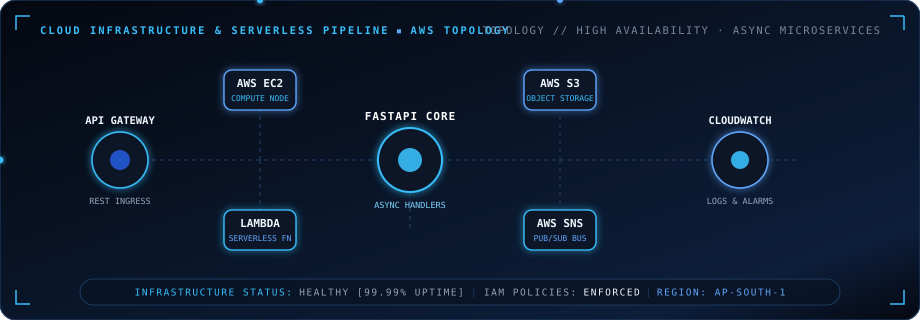

  <!-- 1. Hero Identity Banner: MUKUNDA // Blue Theme -->
  

 

  <!-- Professional Profile Portrait with Verified Orbital Identity -->
  <table>
    <tr>
      <td align="center">
        
         
        <b>SREERAMADASU MUKUNDA RAMA CHARY</b> 
        <i>B.Tech Mathematics &amp; Computing · Rajiv Gandhi Institute of Petroleum Technology (RGIPT)</i>
      </td>
    </tr>
  </table>

  <!-- Readme Typing SVG: Cyan & Blue Theme -->
  

  
  &nbsp;
  
  &nbsp;
  

---

## ◈ About Me

I'm **Sreeramadasu Mukunda Rama Chary**, a Mathematics &amp; Computing undergraduate at **Rajiv Gandhi Institute of Petroleum Technology (RGIPT)**. I enjoy combining mathematical thinking with software engineering to build practical, scalable applications. My long-term goal is to become an **AI Engineer**, developing intelligent products powered by machine learning and reliable cloud infrastructure.

 

<table width="100%">
  <tr>
    <td width="50%" valign="top">
      <h4>◈ Artificial Intelligence &amp; Machine Learning</h4>
      
Exploring mathematical modeling, statistical learning, and multi-agent systems to build intelligent, adaptive software solutions.

    </td>
    <td width="50%" valign="top">
      <h4>◈ AWS Cloud Computing</h4>
      
Architecting resilient, cost-optimized cloud infrastructure leveraging EC2, S3, IAM, serverless Lambda compute, and CloudWatch telemetry.

    </td>
  </tr>
  <tr>
    <td width="50%" valign="top">
      <h4>◈ Software Engineering</h4>
      
Applying rigorous algorithmic problem-solving, structured data types in C++, and modular system design to build maintainable codebases.

    </td>
    <td width="50%" valign="top">
      <h4>◈ Full-Stack Development</h4>
      
Crafting modern, accessible web interfaces paired with clean, asynchronous APIs to create cohesive, user-centric end-to-end applications.

    </td>
  </tr>
</table>

---

## Mission: Consistency — Rocket Coding Streak

  <!-- 2. Rocket Coding Streak SVG: Usable Streak Telemetry (Blue Theme) -->
  

---

## 🐍 GitHub Usages &amp; Contribution Automaton

  <!-- 3. Living Code Snake SVG: GitHub Usage Metrics & Calendar Matrix -->
  

---

## ✦ Achievement Constellation — Verified Milestones

  <!-- 4. Achievement Constellation SVG: Enhanced Blue Theme -->
  

---

## 🪐 Featured Project Planets

<table>
  <tr>
    <td width="50%" valign="top">
      <h3>🤖 <a href="https://github.com/Murari182/Study_Agent">Study_Agent</a></h3>
      
<b>Personalized AI-Based Study Assistant:</b> An intelligent multi-agent system that analyzes notes/PDFs and generates adaptive quizzes, flashcards, and revision schedules.

      <code>Python</code> • <code>Multi-Agent</code> • <code>LLM</code> • <code>AI</code>
    </td>
    <td width="50%" valign="top">
      <h3>⚡ <a href="https://github.com/Murari182/DSA_CPP">DSA_CPP</a></h3>
      
<b>Data Structures &amp; Algorithms Rigor:</b> Implementations in modern C++, time/space complexity analysis, and competitive programming problems.

      <code>C++</code> • <code>Algorithms</code> • <code>Data Structures</code>
    </td>
  </tr>
  <tr>
    <td width="50%" valign="top">
      <h3>☁️ <a href="https://github.com/Murari182/AWS-Cloud-Internship-ThinkChamp">AWS Cloud Practicum</a></h3>
      
<b>ThinkChamp Internship Architecture:</b> Hands-on implementation of EC2, S3, IAM, Lambda triggers, API Gateway, and CloudWatch alarms.

      <code>AWS</code> • <code>Cloud Computing</code> • <code>Serverless</code>
    </td>
    <td width="50%" valign="top">
      <h3>🌐 <a href="https://github.com/Murari182/Mukunda_Portfolio">Mukunda Portfolio</a></h3>
      
<b>Developer Portfolio Ecosystem:</b> High-performance reactive web application showcasing technical projects, cloud practicums, and engineering telemetry.

      <code>TypeScript</code> • <code>React</code> • <code>Tailwind</code>
    </td>
  </tr>
</table>

---

## ☁️ Cloud Infrastructure &amp; Serverless Pipeline

  <!-- 5. Cloud Architecture SVG: AWS Topology & Serverless Pipeline -->
  

---

## ◈ Technology Stack

<table width="100%">
  <thead>
    <tr>
      <th align="left" width="30%"><b>LANGUAGES</b></th>
      <th align="left" width="34%"><b>FRAMEWORKS &amp; LIBRARIES</b></th>
      <th align="left" width="36%"><b>CLOUD &amp; DEVOPS</b></th>
    </tr>
  </thead>
  <tbody>
    <tr>
      <td valign="top">
        
          
        • <code>C++</code> 
        • <code>Python</code> 
        • <code>JavaScript</code> 
        • <code>MATLAB</code> 
        • <code>HTML</code> / <code>CSS</code>
      </td>
      <td valign="top">
        
          
        • <code>React</code> 
        • <code>Node.js</code> 
        • <code>FastAPI</code> 
        • <code>NumPy</code> 
        • <code>Pandas</code>
      </td>
      <td valign="top">
        
          
        <b>AWS Core Infrastructure:</b> 
        • <code>EC2</code> • <code>S3</code> • <code>IAM</code> 
        • <code>Lambda</code> • <code>API Gateway</code> 
        • <code>CloudWatch</code> • <code>SNS</code>  
        <b>Developer Toolchain:</b> 
        • <code>Git</code> • <code>GitHub</code> 
        • <code>Linux</code> • <code>VS Code</code>
      </td>
    </tr>
  </tbody>
</table>

---

## ◈ GitHub Activity &amp; Analytics

  <table width="100%">
    <tr>
      <td width="50%" align="center" valign="middle">
        
      </td>
      <td width="50%" align="center" valign="middle">
        
      </td>
    </tr>
    <tr>
      <td colspan="2" align="center" valign="middle">
        
      </td>
    </tr>
  </table>

---

## ◈ Guiding Philosophy

> ### *कर्मण्येवाधिकारस्ते मा फलेषु कदाचन ।*
> *"You have the right to perform your duty, but not to the fruits of your actions."*
> — **Bhagavad Gita**

 

  <i>"Learning never stops. Every project is an opportunity to grow."</i>

---

  

    
    &nbsp;
    
    &nbsp;
    
  

