

<!-- ======================================================================= -->
<!-- 1. ANIMATED HERO BANNER (LIGHT-THEME LIQUID GLASS WAVE + SVG FALLBACK)  -->
<!-- ======================================================================= -->
<a href="https://murari182.github.io/">
  <picture>
    <source media="(prefers-reduced-motion: reduce)" srcset="assets/banner-static.svg" />
    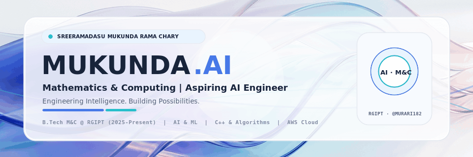
  </picture>
</a>

 

<!-- ======================================================================= -->
<!-- 2. PREMIUM PILL-SHAPED LIGHT SOCIAL LINKS                               -->
<!-- ======================================================================= -->

  
  &nbsp;&nbsp;
  
  &nbsp;&nbsp;
  

---

<!-- ======================================================================= -->
<!-- 3. 01 — ABOUT ME (TWO-COLUMN PORTRAIT & INTRODUCTION)                   -->
<!-- ======================================================================= -->

  

<table>
  <tr>
    <td width="270" align="center" valign="middle">
      
       
      <b>Sreeramadasu Mukunda Rama Chary</b>
       
      <code>@Murari182</code> · <b>MUKUNDA.AI</b>
    </td>
    <td valign="middle">
      <h3>Hi, I'm Mukunda!</h3>
      

        I'm a <b>B.Tech Mathematics and Computing</b> student at <b>Rajiv Gandhi Institute of Petroleum Technology (RGIPT)</b> with a strong interest in <b>Artificial Intelligence</b>, <b>Machine Learning</b>, <b>Data Structures &amp; Algorithms</b>, <b>Full-Stack Development</b>, and <b>Cloud Computing</b>.
      

      

        I enjoy combining mathematical thinking with practical software engineering to build intelligent and useful technology products.
      

      

        <b>Career Goal:</b> Aspiring <b>AI Engineer</b>
      

      

        
        
        
      

    </td>
  </tr>
</table>

---

<!-- ======================================================================= -->
<!-- 4. 02 — EDUCATION                                                       -->
<!-- ======================================================================= -->

  

  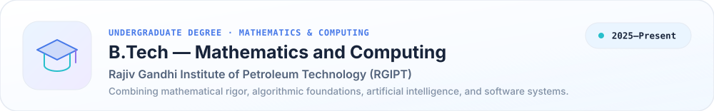

<!-- ======================================================================= -->
<!-- 5. WHAT I AM INTERESTED IN (5-CARD LIGHT VISUAL GRID)                   -->
<!-- ======================================================================= -->

  

  

---

<!-- ======================================================================= -->
<!-- 6. 03 — SELECTED WORK (EDITORIAL SHOWCASE WITH ALTERNATING LAYOUT)      -->
<!-- ======================================================================= -->

  

<table>
  <!-- Project 01: BigO Studio (Visual Left, Editorial Copy Right) -->
  <tr>
    <td width="46%" align="center" valign="middle">
      <a href="https://murari182.github.io/projects.html">
        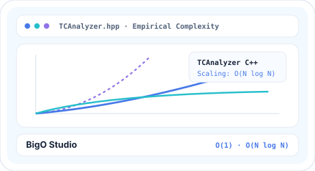
      </a>
    </td>
    <td width="54%" valign="middle">
      <code>01 · ALGORITHMS &amp; COMPLEXITY ANALYSIS</code>
      <h3>BigO Studio (with TCAnalyzer C++ Library)</h3>
      

        An algorithm benchmarking and empirical time-complexity analysis studio paired with the custom <b>TCAnalyzer C++ library</b>. Profiles execution timings across scaling input sizes and compares empirical runtime growth curves against theoretical asymptotic bounds.
      

      

        
        
        
      

      

        <a href="https://github.com/Murari182/DSA_CPP"><b>Explore C++ Algorithms ↗</b></a> &nbsp;·&nbsp;
        <a href="https://murari182.github.io/projects.html"><b>Interactive Complexity Preview ↗</b></a>
      

    </td>
  </tr>

  <!-- Project 02: CollegeConnects (Editorial Copy Left, Visual Right) -->
  <tr>
    <td width="54%" valign="middle">
      <code>02 · FULL-STACK STUDENT PLATFORM · CIO</code>
      <h3><a href="https://github.com/Murari182/COLLOEGECONNECTS">CollegeConnects</a></h3>
      

        A full-stack college counselling and student guidance ecosystem where I serve as <b>Chief Information Officer (CIO)</b>. Connects prospective students with verified institutional insights, structured mentorship workflows, and responsive counselling tools.
      

      

        
        
        
        
      

      

        <a href="https://github.com/Murari182/COLLOEGECONNECTS"><b>Frontend Repo ↗</b></a> &nbsp;·&nbsp;
        <a href="https://github.com/Murari182/COLLOEGECONNECTS_Backend"><b>Backend Repo ↗</b></a> &nbsp;·&nbsp;
        <a href="https://collegefront.vercel.app"><b>Live Web App ↗</b></a>
      

    </td>
    <td width="46%" align="center" valign="middle">
      <a href="https://collegefront.vercel.app">
        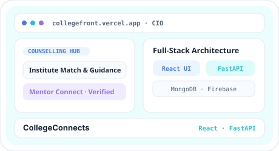
      </a>
    </td>
  </tr>

  <!-- Project 03: AI-Powered Study Assistant (Visual Left, Editorial Copy Right) -->
  <tr>
    <td width="46%" align="center" valign="middle">
      <a href="https://github.com/Murari182/Study_Agent">
        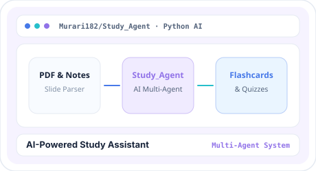
      </a>
    </td>
    <td width="54%" valign="middle">
      <code>03 · ARTIFICIAL INTELLIGENCE &amp; MULTI-AGENT WORKFLOWS</code>
      <h3><a href="https://github.com/Murari182/Study_Agent">AI-Powered Study Assistant</a></h3>
      

        An AI multi-agent system (<code>Study_Agent</code>) engineered in Python that ingests lecture PDFs, slides, and unstructured academic notes to automatically synthesize structured summaries, active-recall flashcards, interactive quizzes, and adaptive study plans.
      

      

        
        
        
      

      

        <a href="https://github.com/Murari182/Study_Agent"><b>View Repository (Murari182/Study_Agent) ↗</b></a>
      

    </td>
  </tr>

  <!-- Project 04: CineReserve (Editorial Copy Left, Visual Right) -->
  <tr>
    <td width="54%" valign="middle">
      <code>04 · INTERACTIVE FRONTEND ARCHITECTURE</code>
      <h3>CineReserve</h3>
      

        An interactive cinema seat reservation and ticketing interface featuring real-time auditorium seat-map matrices, dynamic pricing tier state management, showtime filtering, and instant booking confirmation summaries.
      

      

        
        
        
      

      

        <a href="https://murari182.github.io/projects.html"><b>Interactive Seat Matrix Demo ↗</b></a>
      

    </td>
    <td width="46%" align="center" valign="middle">
      <a href="https://murari182.github.io/projects.html">
        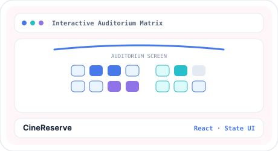
      </a>
    </td>
  </tr>

  <!-- Project 05: DSA_CPP Repository (Visual Left, Editorial Copy Right) -->
  <tr>
    <td width="46%" align="center" valign="middle">
      <a href="https://github.com/Murari182/DSA_CPP">
        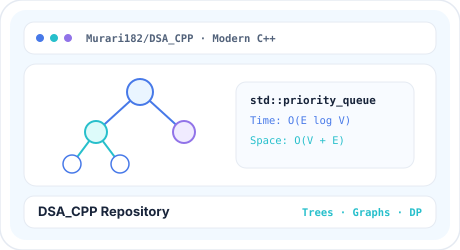
      </a>
    </td>
    <td width="54%" valign="middle">
      <code>05 · DATA STRUCTURES &amp; ALGORITHMS IN C++</code>
      <h3><a href="https://github.com/Murari182/DSA_CPP">DSA_CPP Repository</a></h3>
      

        A structured collection of Data Structures and Algorithms implemented in modern <b>C++</b>. Covers arrays, linked lists, trees, graphs, recursion, sorting, dynamic programming, and STL containers with clear time and space complexity documentation.
      

      

        
        
        
      

      

        <a href="https://github.com/Murari182/DSA_CPP"><b>View Repository (Murari182/DSA_CPP) ↗</b></a>
      

    </td>
  </tr>
</table>

---

<!-- ======================================================================= -->
<!-- 7. TECHNOLOGY CONSTELLATION (VERIFIED LIGHT-THEME TOOLKIT)              -->
<!-- ======================================================================= -->

  

  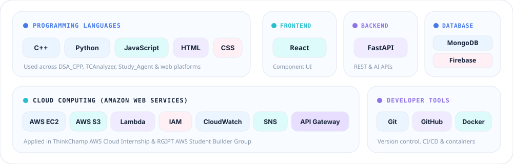

---

<!-- ======================================================================= -->
<!-- 8. 04 — EXPERIENCE & LEADERSHIP                                         -->
<!-- ======================================================================= -->

  

  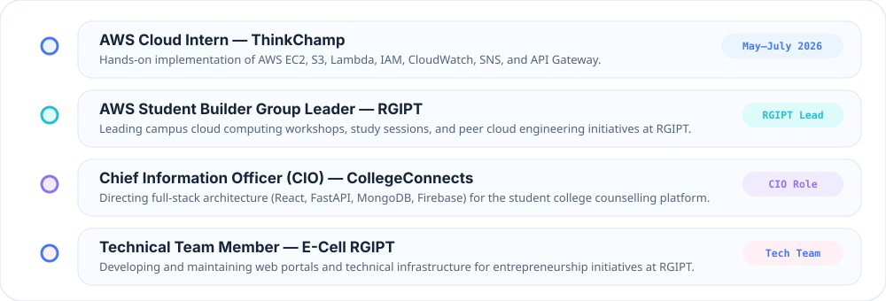

<table>
  <tr>
    <td width="50%" valign="top">
      <h4>☁️ <a href="https://github.com/Murari182/AWS-Cloud-Internship-ThinkChamp">AWS Cloud Intern — ThinkChamp</a></h4>
      
<code>May–July 2026</code> · Cloud Infrastructure &amp; Serverless

      
Hands-on cloud engineering with <b>AWS EC2, S3, IAM, Lambda, CloudWatch, SNS, and API Gateway</b>, building static hosting pipelines and serverless cloud architectures.

    </td>
    <td width="50%" valign="top">
      <h4>🚀 AWS Student Builder Group Leader — RGIPT</h4>
      
<code>RGIPT Campus Leadership</code> · Cloud Community

      
Leading student cloud computing workshops, architectural study jams, and hands-on AWS builder sessions at Rajiv Gandhi Institute of Petroleum Technology.

    </td>
  </tr>
  <tr>
    <td width="50%" valign="top">
      <h4>🏛️ <a href="https://github.com/Murari182/COLLOEGECONNECTS">Chief Information Officer (CIO) — CollegeConnects</a></h4>
      
<code>Executive Technical Leadership</code> · Full-Stack Platform

      
Directing technical architecture, frontend/backend engineering (React, FastAPI, MongoDB, Firebase), and platform delivery for the CollegeConnects student guidance ecosystem.

    </td>
    <td width="50%" valign="top">
      <h4>💡 Technical Team Member — E-Cell RGIPT</h4>
      
<code>Entrepreneurship Cell</code> · Web &amp; Platform Engineering

      
Building and maintaining web portals, event platforms, and technical workflows supporting student entrepreneurship initiatives at RGIPT.

    </td>
  </tr>
</table>

---

<!-- ======================================================================= -->
<!-- 9. 05 — GITHUB ACTIVITY (EXCLUSIVELY LIGHT-THEME CARDS)                 -->
<!-- ======================================================================= -->

  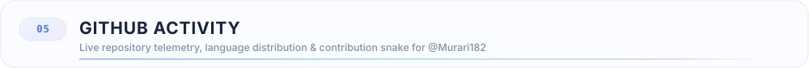

  <a href="https://github.com/Murari182">
    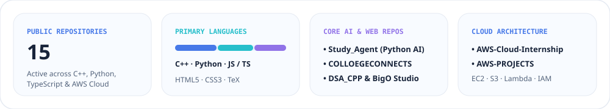
  </a>

  
  &nbsp;
  

  

<!-- ======================================================================= -->
<!-- 10. LIGHT-THEME CONTRIBUTION SNAKE                                      -->
<!-- ======================================================================= -->

  <a href="https://github.com/Murari182">
    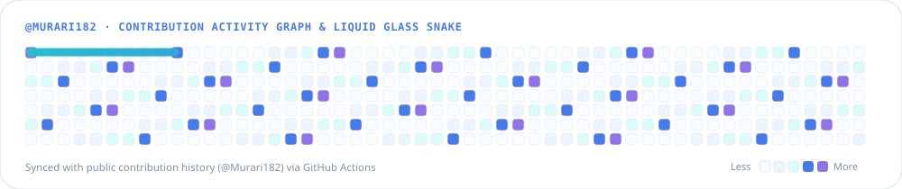
  </a>

---

<!-- ======================================================================= -->
<!-- 12. 07 — LET'S CONNECT                                                  -->
<!-- ======================================================================= -->

  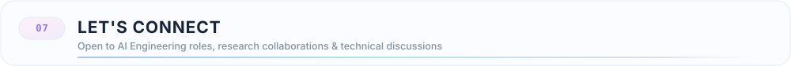

  Always happy to connect with fellow builders, researchers, and engineers working on <b>AI systems</b>, <b>algorithmic tooling</b>, <b>full-stack platforms</b>, and <b>cloud architecture</b>.

  
  &nbsp;&nbsp;
  
  &nbsp;&nbsp;
  

 

<!-- ======================================================================= -->
<!-- 13. CUSTOM SVG FOOTER SIGNATURE                                         -->
<!-- ======================================================================= -->

